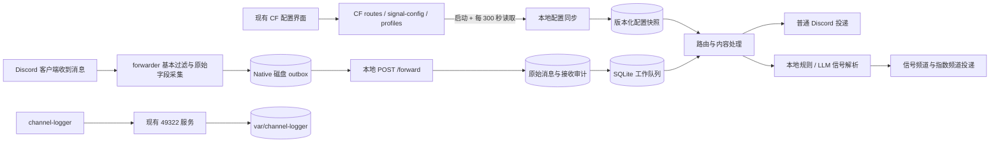

# Signal Hub 本地化与最小侵入 Vencord fork 规划

日期：2026-11-15，Asia/Shanghai。

本文保留代码核对后的设计基线与完整验收规划。随后已按用户指示切到临时 `local` 分支，完成两个插件的构建 profile / 命名迁移、本机与内网 local 交接、SQLite 服务、配置缓存、任务投递及防回流核心实现；实际运行说明和已知边界见 `docs/signal-hub-operations.md`，固定参考与语音探索见 `docs/signal-hub-reference.md`。下文的准备阶段基线与阶段目标不应被视为全部已经完成的生产验收。

同日复审后补充：插件 remote 在过渡期继续兼容旧 CF Worker，local 使用独立采集协议；任务按创建时快照固定内容和目标；增加统一启动配置脚本、逐 route 决策和逐次投送记录，以及“首次失败后指数退避重试五次、耗尽后定时扫描补发”。新增积压监控、按原消息追踪及分级钉钉摘要；严重故障及时通知、持续故障定期提醒，持久化限频并合并消息。实现细节和异常结果对账边界以运行说明为准，复审发现见 `docs/signal-hub-review.md`。

本次修订纳入：统一 `channel-logger` 命名、新 CF 分支架构、配置同步失败继续使用缓存、完整消息类型与 400 契约问题、多层防漏与时延设计，以及已获授权的凭据读取和必要钉钉通知。修订阶段增加了离线 400 复现和线上只读接口核对，没有向生产 `/forward` 发送测试消息。

最新职责收敛：local 插件只做基本来源过滤、原始字段采集和可靠交接。排除非 Discord server 消息、当前账号本人发送的消息及固定不监听的 server，其余收到的消息基本全部上送；本地服务对实际接收内容全量保存，再负责业务过滤、转发和信号解析。客户端补采、配置同步、目标投递及告警编排不纳入 local 插件实现。放宽通知资格筛选不能解除现有排除边界或引入转发回路。

文档集中在 `docs/` 根目录。本文整合两份旧恢复规划中仍适用的诊断、独立健康检查、统计和告警要求；旧实施步骤已由当前插件及其 README 记录，不再保留重复规划或附加写作流程。

## 1. 目标与边界

1. 本地 Vencord 分支从 `codex/plugins` 更名为 `signal-hub`，持续合并上游。
2. 最小侵入：只注册两个可选功能插件，并默认启用：`forwarder` 与 `channel-logger`。后者从现有 `ChannelLogger` 更名，插件目录、显示名、native 注册键及自有服务目录统一命名，并兼容迁移旧设置。
3. `forwarder` 增加明确的 `local` / `remote` 模式。本地模式排除非 Discord server 消息、本人、固定不监听 server 及无效/optimistic 占位事件，将其余收到消息的原始字段交给本地服务。通知资格不作为 local 过滤条件；配置、保存、业务过滤、转发、路由、信号解析和投递由本地服务负责。
4. Cloudflare 上现有界面继续作为转发配置的编辑入口。本地启动时后台同步配置，此后每 300 秒同步一次；任何同步失败都不阻断程序运行，有本地缓存时继续按缓存执行。
5. 本地服务实际接收到的消息先持久化，再做业务过滤、路由和解析；未命中、被过滤、重复、失败等都可追溯。“全量保存”以通过插件基本规则并到达本地服务的内容为边界，不要求保存已在插件排除的 DM、本人或固定不监听 server 的消息正文。
6. 本地服务代码位于 Vencord 根目录的 `signal-hub/`；运行数据统一放在 `signal-hub/var/`。原需求中的 `siganl-hub/var` 按目录拼写统一为 `signal-hub/var`。
7. 探索发现语音频道/Go Live、自动加入、录音、实时转录。探索结果作为 `forwarder` 内部的可选能力，不新增第三个注册插件。
8. 优先修复传输契约兼容性，分层提升及时性与稳定性，通过持久化、重放、补采、对账、监督重启和告警减少漏发；不把重复 HTTP 请求视作独立业务投递。
9. 必要 token 优先从已授权且可读的 Cloudflare 配置/数据中获取；实际需要新认证时由用户协助认证，平台不可导出的值再由用户补充。必要时使用用户提供的 DingTalk webhook 发出运行故障及恢复通知；这些业务凭据留在 server。

“默认启用”指新设置的默认值；不在每次启动时强制覆盖用户明确关闭的设置。`channel-logger` 启用后仍按当前选中的频道工作，不自动勾选所有频道。下文的 `ChannelLogger` / `channelLogger` 只在描述当前源码、旧设置键或已运行的历史验证命令时保留。

Vencord 的 Settings、ContextMenuAPI 等 `_core` / `_api` 注册属于运行基础设施，继续沿用上游机制；限制的是可选功能插件。不能直接把整个注册表清空后只留下两个条目，否则会破坏设置页面和频道右键菜单。

术语统一：Discord 的服务器称为 **server**；运行 HTTP、存储及转发逻辑的程序称为 **signal-hub server / 本地服务**。新增设置、内部模型、日志和界面采用 `server` / `serverId`。仅在 Discord 原始字段 `guild_id`、现有 `GuildStore` 或 legacy 协议的 `guildId` / `metadata.guild` 必须兼容时保留原名；边界 adapter 映射为 `serverId`，原始归档不改写，不为术语统一批量重命名上游 API。

## 2. 已完成的准备与代码事实

### 2.1 Git 状态

| 项目 | 核对结果 |
| --- | --- |
| Vencord 本地分支 | 已从 `codex/plugins` 更名为 `signal-hub` |
| 当前 HEAD | `a276f10a`，已有上游合并及自定义插件兼容调整 |
| 上游刷新 | 已执行 `git fetch --all --prune` |
| 当前 `origin/main` | `d07030c0968e31e41caa0c35fda0ef8ae63a079e`，2026-11-11 提交 |
| 上游同步 | `git merge --ff-only origin/main` 返回 `Already up to date`，没有需要补合并的提交 |
| 当前 tracking | 仍为 `iondex/codex/plugins`；没有推送新分支或删除远端旧分支 |
| 原有工作区改动 | `pnpm-lock.yaml` 已存在未提交改动，保留原样 |
| 参考仓库 | `/Users/iondex/dev/forwarder-signal-hub-reference` |
| 参考分支 | 已 checkout `signal-hub`，跟踪 `origin/signal-hub` |

### 2.2 参考实现要区分三个版本

| 参考 | 固定版本 | 适合复用 | 不能直接照搬 |
| --- | --- | --- | --- |
| 旧生产 Signal Hub | `signal-hub` / `6e240f034bb2ff6e6a105e73057e1a89d8d3706e` | `apps/relay-worker` 的路由、内容处理、附件、Discord 投递；`packages/signal-parser`；`apps/signal-worker` 的解析状态语义 | D1、Queue、Service Binding 和“过滤后才入库” |
| 新 CF 服务架构，主要借鉴对象 | `origin/forwarder` / `e0305df72b1808d31e31c971e8e9c094caae25b3` | 单 Worker + D1 + 同源静态管理界面；`apps/forwarder/src` 的契约、执行接口、Signal deadline、配置兼容及指数频道修复 | Worker `waitUntil`/进程内 Promise 不能替代本地持久化队列；当前 schema 的 null 兼容问题和泛化的 400 错误需修复 |
| Node 包装实验 | `6e809a2`，并核对 `8781026`、`a2d43bd` | `experiments/forwarder-server` 的 HTTP 适配、生命周期、关闭和 parity 测试 | Miniflare/D1 模拟器作为最终本地生产存储；启动时反复执行建库 SQL |

`signal-hub` 分支当前根目录已是生产工作区，实验目录不在该分支 HEAD 的可见文件中，需要通过已经 fetch 到的其他分支和历史提交读取。不能因为当前目录没有 `experiments/` 就漏掉这部分参考。

三种参考明确分工：新的 `forwarder` CF 分支提供当前服务边界和接口基线，旧 `signal-hub` 补充已有生产语义和异步恢复经验，Node 实验提供宿主适配经验。不能把新的 CF 架构与 Node 包装实验混为一谈，也不把旧 Worker + Queue 拓扑原封不动搬到本地。

旧实现 `processForwardRequest` 在 notification safety、路由匹配和内容过滤之后才执行 `saveMessageIdempotent`；新的 `apps/forwarder/src/forward.ts` 也保留这个顺序。它们都不满足此次“全量接收消息入库”的要求，必须调整入口顺序。

### 2.3 Vencord 当前实现

- `src/plugins/forwarder.desktop/index.tsx`：监听 `MESSAGE_CREATE`，构造包含 raw message、附件、Embed、reply 和频道上下文的 payload。
- `logic.ts`：当前会过滤本人、非 Discord server 消息和 Discord 判断不需要通知的消息。
- `native.ts`：已有 HTTP 错误分类、脱敏、重试、fallback 和最终 DingTalk 告警，但没有持久化 outbox。
- 当前 primary URL 已是 `127.0.0.1:49321/forward`，但它仍属于旧的 primary/fallback 行为，不能据此视作已经实现 local 模式。
- `ChannelLogger` 已有独立服务 `scripts/channelLogger`，默认端口 49322，使用 `node:sqlite`，保存选中频道的可见/加载消息、版本、删除事件和导出。
- Renderer 注册由 `scripts/build/common.mjs` 生成；native 注册由 `scripts/build/build.mjs` 独立生成。只改一个入口会留下不一致的插件 helper 或注册信息。
- `enabledByDefault` 已是上游支持的插件属性，无需修改通用 Settings 默认值算法。

### 2.4 修订阶段的线上只读核对

2026-11-15 刷新参考仓库后，分支仍包含 `main`、`signal-hub` 和 `forwarder`；上述 SHA 未变化。对新分支配置的 `forwarder.yufeng.run` 只读检查结果：

| 请求 | 结果 | 设计含义 |
| --- | --- | --- |
| `/healthz` | HTTP 200 | 新 CF 服务端点可达 |
| `/api/admin/config` | HTTP 200，返回 server/sources/sinks | 可确认实际 API 响应形状，不能以仓库结构代替线上核对 |
| `/routes?page=1` | HTTP 200，10 条，total=51 | 实际需要读取多页，第一页远不足以构成有效快照 |
| `/api/admin/signal-config` | HTTP 200，包含 route 级配置及指数目标字段 | 新架构的同步 adapter 应按此版本验证；不能要求旧架构独有的字段存在 |

本次没有读取或输出任何生产 secret，没有执行生产转发、修改配置或发送钉钉测试通知。旧服务 health 请求出现网络异常，只记录为该次请求失败，不据此推断其生产资源已停用。

### 2.5 本轮回路与排除边界审查

- 当前插件 `getForwardSkipReason` 明确排除本人消息、非 server 消息和通知判断不通过的消息；现有逻辑测试覆盖本人排除。`shouldForward` 在进入 payload 构造和 native 发送前执行该判断。
- 在已核对的插件过滤入口及新旧 CF safety 入口中，没有找到一份明确的固定 server 排除名单。CF safety 主要检查私信类型和 server 上下文。此结果不能证明是否存在部署级排除，也不据此杜撰一份必须非空的名单；若实际已有排除项则保留。
- 2026-11-15 对当前新 CF 服务执行只读配置核对：`GET /routes?page=1..6` 共取得 51 条不同 route，各页 total 一致；45 条启用 route 全部限定明确来源频道，其中 1 条另有作者限制，没有仅按作者匹配整个 server 的启用 route。31 个不同普通目标频道均不在启用来源频道集合内；Signal 配置的 2 个全局目标也不在该集合内。
- 因而在这次读取的配置下，普通转发的目标消息即使重新被插件收到，也不会匹配任何启用来源 route；它不需要排除整个目标 server 来实现这一点。本人过滤和 remote 通知筛选是另两层入口约束。这能解释当前配置的正常行为，不能证明所有历史部署或后续配置天然无回路。
- local 取消通知资格筛选仍需核对并保留既有明确排除项，但固定 server 排除是可选附加边界，可以为空。没有显式排除名单本身不构成必须新增整 server 屏蔽的理由；必须通过验收的是本地服务自身输出不会被再次执行。
- 此轮是源码、线上只读配置与规划审查；尚未验证实际账号的不监听 server ID、现网 Bot/webhook 输出身份或实际回流场景。第 5.6、13.2 节规定实施与回归要求，不声称这些新增防护已经实现；未发送生产测试消息或通知。
- 已重新运行现有 forwarder 逻辑测试并通过，确认当前本人/非 server 过滤基线；这些既有测试不覆盖新增 local 的输出回流或固定排除名单，不能代替专项验收。

## 3. 总体架构



本地化指执行位置在本机。Discord 目标投递仍请求 Discord API；选择远程模型时，信号解析仍请求对应模型服务。它不等于离线运行。

本地服务独立于 Discord Electron 进程。插件负责采集和可靠交接；独立服务负责配置、存储、路由、解析、限流、重试和运维。Discord 重载不应打断已接收的处理任务。

local 执行路径不读取 CF routes、模型 key、Bot/webhook token 或钉钉凭据；只需要本地地址、运行目录和可选 pairing token。pairing token 默认留空，服务对应字段为空时无需鉴权。remote 原有设置独立保留。服务端完成持久化后的业务失败，不回流为插件重新执行业务的理由。

## 4. 最小侵入的双插件构建

### 4.1 构建方式

在 fork 增加一个很小的本地 profile 文件和一个共享选择函数，例如：

```text
signal-hub/plugin-profile.json
scripts/build/pluginProfile.mjs
```

profile 声明允许的功能目录和对应运行时名称：

```json
{
  "plugins": [
    { "directory": "forwarder.desktop", "name": "forwarder" },
    { "directory": "channel-logger.desktop", "name": "channel-logger" }
  ]
}
```

实施要求：

1. 保持上游所有插件源文件及目录原位；仅对自有 `channelLogger.desktop` / `scripts/channelLogger` 做更名为 `channel-logger.desktop` / `scripts/channel-logger` 的机械迁移，不逐个修改上游插件。
2. 共享 helper 在本 fork 的所有构建中默认读取受版本管理的本地 profile；缺失/损坏时明确失败，不静默退回全部插件。未改造的上游分支自然继续使用原有构建机制。
3. `common.mjs` 的 renderer 注册与 `build.mjs` 的 native 注册使用同一份选择结果；生成插件元数据的脚本也应遵循同一 profile，避免产物描述与运行时不一致。
4. 原有 `.desktop` 等目标判断继续生效，不把 desktop 插件强塞进 Web 产物。此次主要交付桌面 fork；Web 产物不宣称具备本地 native 功能。
5. `_core` / `_api` 沿用上游实现，不尝试另造 Settings 或 ContextMenuAPI。必要依赖仍由上游机制启用。
6. 为两个插件增加 `enabledByDefault: true`；注册名为 `forwarder` / `channel-logger`，通过上游既有设置迁移 API 复用旧频道记录配置。
7. 不批量删除旧插件设置，也不把所有可选插件先加载后隐藏。未被选择的功能插件不能进入生成的 import/注册表。
8. reporter、standalone、native helper 和元数据路径都应检查 profile；不能以 reporter 模式为由绕过本地功能列表。

预计触碰的上游文件仅为构建入口及元数据生成入口。两插件的功能改动仍集中在其现有目录；不修改通用 PluginManager、SettingsStore 或所有上游插件。

### 4.2 验收

- 桌面构建的可选功能插件集合恰好为 `{ forwarder, channel-logger }`，native helper 集合对应这两个插件；不存在重复注册的旧名称。
- 新设置默认启用两者；明确关闭后重启仍保持关闭。
- 原有其他插件即使 settings 中存有 `enabled: true`，也不被注册或执行。
- 设置页、频道右键菜单、启动和停止逻辑正常。
- 不为语音探索额外注册 ConsoleShortcuts、VoiceMessages 或新的录音插件；只参考其代码。

### 4.3 channel-logger 更名迁移

- 使用现有 `migratePluginSettings("channel-logger", "ChannelLogger", "channellogger")`，在首次解析插件设置前迁移；保留 enabled、serverUrl 和 enabledChannels。新名称已存在时，不覆盖用户的新设置。
- native 调用改为 `VencordNative.pluginHelpers["channel-logger"]`，同时修改插件 name、日志标识、构建 profile、服务入口脚本和当前文档；不能只改设置页上的显示文字。
- 历史数据库表名与 `channel-logger.sqlite3` 文件无需重建。目录移动采用明确的数据迁移步骤，旧数据未搬迁成功前不删除来源。
- 本文的基线验证记录保留实际执行时的旧路径；实施后的运行脚本、README 和新验收命令全部使用新路径。两份旧恢复规划合并后移除。

## 5. forwarder 的 local 模式

### 5.1 基本过滤、消息范围与职责

local 监听现有 `MESSAGE_CREATE`，只做少量基本检查：具有有效 message ID / channel ID、属于 Discord server、未命中固定 server 排除名单、作者不是当前账号本人、不是 optimistic 本地占位事件。server 内线程包含在内，DM 与 Discord group DM 不属于该范围。本人及 server 排除判断在 payload 构造、native 落盘和 HTTP 发送前完成。

- 通过基本检查的普通文本、其他用户、bot/webhook、Embed-only、附件-only、回复及未知消息类型都上送；不在插件侧按 route、业务频道清单、关键词、中文或 Signal 开关筛选。固定 server 排除属于基本安全边界，不能随“基本全部上送”一起删除。
- local 不调用 `notificationsShouldNotify` 决定去留，也不为此额外接入通知内部模块。未被排除 server 中的前台、静音或没有系统通知的消息同样上送。临时通知状态与明确的不监听 server 分开处理；本地服务不能再次用缺失/false 的通知资格字段阻止接收归档或合法 route 的处理。
- 插件基本过滤只增加分类计数和必要诊断，不上送被排除消息的正文。本地服务无法查询未收到的 DM、本人或固定不监听 server 的消息，这是本次明确的范围。
- 本地服务发送的 bot/webhook 消息通常不是当前账号本人，仍可能到达本地服务。先归档，再按第 5.6 节的投递身份、目的频道和持久化发送记录标为 `self_generated`，不继续路由/解析/投递；插件无需维护目标身份或投递 ID 集合。
- `channel-logger` 继续按自己的选中频道和既有加载/编辑/删除语义工作，其采集范围不由 forwarder 的基本规则反向改变。本地服务可读取其已有记录对账，不能把其中的 DM、本人或固定不监听 server 的记录重新注入转发链路，也不能把历史编辑或删除当作新交易信号。

两种模式保留清晰差异：

| 项目 | local | remote |
| --- | --- | --- |
| 插件接收筛选 | 本人、非 server、固定不监听 server 等基本过滤后基本全部上送 | 保留现有基本过滤、通知资格及不监听边界 |
| 消息协议 | 原始消息字段 + 小型 transport envelope；由 server 规范化 | 现有 `source/notification/metadata/message` legacy payload，修复已确认的契约兼容问题 |
| 插件业务能力 | 无路由、内容变换、附件下载、模型调用或目标投递 | 保持现有 remote 分工，不因 local 放宽采集而改变其行为 |
| 目的地与失败处理 | 本机 server；磁盘暂存、ACK、重试 | 已配置的 remote primary/fallback 与现有恢复逻辑 |
| 成功含义 | server 已持久化接管；目标投递结果由 server 记录 | 沿用 remote 接口的现有响应含义 |

插件文字链路的改动集中在现有 `index.tsx` 的 mode 分流与最小采集、`logic.ts` 的基本过滤、`native.ts` 的窄化 local 交接。固定 server 排除只增加小型 ID 集合判断，不在插件内分析路由图或维护业务身份库。不在 renderer/native 中新增 CF 配置同步器、历史扫描/补采器、路由/模型队列或完整告警引擎；只复用无副作用的 JSON 安全序列化等已有工具。local 不为对齐 legacy payload 去做 reply 拉取、通知标题拼接、媒体渲染或丰富的 store 查询，这些在本地服务完成。

实时采集边界是“客户端已收到且通过基本规则的事件”。补偿机制放到 server：从现有 logger 做只读对账，或在具备来源频道读取权限的 Bot 凭据时补采历史。若拿到的 token 只能向目标发送，不能据此承诺来源历史补采；也不增加客户端 REST 代理或导出用户会话 token 来扩大插件范围。

### 5.2 设置与兼容

新增或明确以下设置：

| 设置 | 建议行为 |
| --- | --- |
| `mode` | 本地（Local）/远程（Remote）标签页；未设置时默认 `local`，已保存的选择保留，切换后重启生效 |
| `localServerUrl` | 默认 `http://127.0.0.1:49321/forward`；支持本机或内网机器的 HTTP(S) 地址，不允许 URL 内嵌凭据或自动重定向 |
| 本机发送队列目录 | 自动使用 Vencord 数据目录下的 `signal-hub/var`，未指定数据目录时由构建位置确定；沿用旧自定义目录以保留积压，无需界面配置 |
| `excludedServerIds` | 可选，可为空；保留经核对的既有固定排除项。初始化时给插件与本地服务同一份名单，不从通知资格推导，也不要求把目标 server 整体排除来防循环 |
| 旧 `serverUrl` / `fallbackUrl` | 仅 remote 模式使用，保留现有语义 |
| 服务与转发测试 | 本地标签查询 API、暂停状态、缓存路由和本机队列；选择单条路由创建有审计的测试投递并查询结果，复用现有重试及安全校验，不执行信号解析 |

local 模式绝不自动 fallback 到 CF `/forward`。本地不可用时只在磁盘排队和报告状态，避免破坏本地执行约束、重复投递或使排查数据分散。

local 的 DingTalk 通知由 server 与独立 watchdog 负责，插件只记录传输状态和错误。remote 现有通知逻辑保持独立，不为新增 local 模式强制重构；确需共用的安全诊断工具可以复用。使用用户已提供的地址，但不把该凭据再次写入规划或源码默认值。

### 5.3 可靠交接

1. 基本过滤通过后，renderer 对收到的原始 message 做 JSON 安全采集，附加小型 transport envelope：`schemaVersion`、`eventId`、`eventType`、`capturedAt`、`serverId` 和最少的账号/频道上下文。保留已随事件提供的附件、Embed、reply/snapshot 和扩展字段，但不额外抓取缺失资源。本地服务保存 raw 后完成空值/别名兼容和标准化。local 不复用 remote 的通知筛选或完整 payload 构造流程；不能把新 envelope 发给只接受 legacy 根字段的 CF 接口。
2. Native 先把事件写入 `var/spool/forwarder/`。采用临时文件、文件同步和原子 rename；平台支持时同步目录，明确记录平台持久化边界。IPC 成功表示 native 已接管，不表示已经投递到目标。
3. Native 用独立后台发送循环访问本地服务，设置超时、有限并发、指数退避和抖动，不阻塞 Discord 的 Flux handler。
4. 本地服务只有在数据库事务提交原始事件和对应处理工作后，才返回带 `eventId` 的持久化 ACK。
5. Native 校验 ACK 的 `eventId`、payload hash 和持久化接收状态后，把文件从 `pending/` 原子移至 `acked/`；后者只用于恢复，不再正常发送。网络中断、超时或 Discord 重启后重放未确认项。未确认项不因 TTL 或重试次数自动丢弃。
6. 同一事件重试保持同一 `eventId`。服务另用 Discord message ID 和事件类型作内容幂等键，避免多个会话或多次采集造成重复业务执行。
7. ACK 丢失会产生重复请求；每次接收有审计记录，但同一逻辑消息只创建一次初始业务工作。
8. 永久格式错误转入可查看的 dead-letter；429/5xx/连接错误继续排队。不得无界重试不可修复的 400，也不得静默删除失败事件。

ACK 留存初始建议为至少 72 小时，并覆盖到已经验证的数据库备份水位。保留/清理策略、备份水位和恢复校验由 server/运维进程负责；native 只移动已确认文件、维护未确认发送循环，不引入备份调度器。清理条件和磁盘预算同时可见；磁盘紧张时先报警、清理可再生成的下载/日志等数据，不能悄悄删除未接管消息。`acked/` 与数据库位于同一磁盘，只能补偿数据库误操作或应用层损坏，不是独立硬件备份。

插件 native 只使用 Electron 可用的文件 API 和现有网络能力，不直接依赖 Electron 内的 `node:sqlite` 版本。本地数据库由独立 Node 运行时拥有。

`localRuntimeDir` 应由初始化命令输出并在启用 local 前配置完成。初次配置未完成时明确显示“未就绪”；不能在服务不可达时仍假设可以发现持久化目录，也不能声称尚未配置磁盘队列的事件已得到可靠保存。

### 5.4 消息类型与支持层级

以下矩阵针对通过第 5.1 节基本规则并送达 server 的消息；必须分别回答“能否采集/归档”“能否转换投递”“是否参与 Signal”，不能用一个支持开关代替三种语义。原始 numeric message type、flags、未知字段和 raw payload 均保留；不把 `MESSAGE_CREATE` 事件名等同于普通文本消息类型。

| 消息类别 | 接收与归档 | 目标投递 | Signal 默认行为 |
| --- | --- | --- | --- |
| 普通文本、提及、链接、Markdown | 完整字段和原始 ID/时间 | 按 route 处理并发送 | 按 route 开关解析 |
| 回复、跨频道引用、引用消息不可访问 | 保存引用 ID、可用 reply 内容及 unavailable 标记 | 主消息可独立投递；引用作为上下文/链接 | reply 不能单独制造信号 |
| Discord 转发消息/快照 | 保存 message snapshots、reference type 与 flags | 提取可展示快照，带来源链接；不冒充原生转发身份 | 使用清晰标记的快照文本，按 route 决定 |
| Rich Embed、纯 Embed、webhook/bot 消息 | 标准字段、Vencord aliases、author/footer/fields、媒体元数据 | 经标准化 RenderPlan 重建合法 Embed | 仅使用受支持文本，保留来源层级 |
| 图片、GIF、视频、普通文件、仅附件消息 | 全量 metadata，尽早下载归档 | 按图片/文件策略重传；失败时保留链接与明确状态 | 不把文件名当作正文或虚构入场信号 |
| Voice message/音频附件 | 保存时长、waveform、codec/附件和 flags | 默认文件/链接；满足目标原生语音约束时才原生发送 | ASR 作为可选后续阶段，不能把附件对象直接当文字 |
| Sticker、仅贴纸消息 | 保存 sticker items、格式与可用资源 | 能转换的资源上传，否则带来源链接的文本表示 | 默认不解析贴纸本身 |
| Poll/投票与结果 | 保存问题、选项、结果及到期信息 | 文本摘要/来源链接；不伪造持续更新的投票 | 默认归档，显式 route 才解析正文 |
| Components v1/v2、文本块、卡片、媒体画廊 | 递归保存组件结构与可用资源 | 提取文本/媒体为合法消息，不转发源交互按钮的可执行行为 | 解析稳定可见文字，不执行组件动作 |
| Slash/context command 的可见响应 | 保存可见 message 和 application/interaction metadata | 转换消息内容，不重放原交互 | 按 route 解析可见正文 |
| Thread/forum/media channel 中的消息 | 保存实际 channel ID、parent/server 上下文 | 按明确的子频道/父频道规则映射 | 维持来源时间和 route 语义 |
| 入群、置顶、boost、通话、线程创建等系统消息 | 原始 type、关联对象和事件字段 | 有确定转换规则时发送摘要，否则归档并标记原因 | 默认不触发交易信号 |
| Server 内应用/未知作者消息 | 可空作者字段不导致整条拒绝；已确认本人则在插件基本规则排除 | 有可展示内容且匹配 route 才投递 | 不擅自扩展到未配置的来源 |
| DM/group DM、本人消息 | local 插件不采集上送；兼容/诊断入口若实际收到，server 仍归档并记录边界原因 | 不进入正常转发；logger 对账也应用同一范围约束 | 不解析 |
| Ephemeral/临时、未知新类型、结构不完整消息 | 仅保存客户端实际可见的数据及能力/缺失标记 | 未实现可靠转换时明确 `archived_unsupported`，不能冒充成功投递 | 默认不解析；未来新增适配后可显式重放 |

每种类别至少有：正常样本、nullable/缺失字段、纯该类型无正文、超限、未知扩展字段等 fixture。未知 message type 本身不能导致整个入口 400。

采集与转换遵循：

- snowflake 全程保留字符串；不得经不安全的 number 转换后再“恢复” ID，也不为缺失 ID 随机生成看似有效的业务身份。
- server 规范化层处理 `null`、缺失字段、camelCase/snake_case 和 timestamp；插件仅做传输必需的安全序列化与递归边界控制，原 raw 不做业务改写。对预期为文本的 nullable 值使用明确的空值规则，不对对象执行无意义的 `String(object)`。
- 发给 CF 的 legacy adapter 保持原根结构 `source/notification/metadata/message`；local v2 和归档原始结构可更丰富，两个协议之间有明确转换和版本测试。
- Discord 出站只允许经过校验的 content、embeds、files 等字段，不原样复制源 flags、只读 Embed 字段、完整 components 或原 message 对象。
- 对 content 长度、Embed 总量/字段、文件数量/大小做出站预算和稳定分段。分段以 `jobId + target + partIndex` 幂等，不能靠重复请求碰运气消除 400。
- 附件下载按内容类型选原 URL/代理 URL；代理对非图片文件可能返回不支持错误，允许受控切换到原地址。下载失败不能丢弃原消息。
- 文本为空但含合法媒体/结构化内容时进入对应 renderer；不能再用 `(empty message)` 作为普通正文兜底。

### 5.5 400 Bad Request：已复现事实与修复路径

离线复现直接抽取当前插件的 payload 构造函数，使用固定的新 CF `origin/forwarder` 代码与其 Zod 4.4.3 contract，运行真实 `forward()`。运行时 routes 为空且外部投递被禁止，未向生产发送消息。

复现命令，诊断文件位于独立临时目录，不参与产品构建：

```sh
node /tmp/vencord-signal-hub-contract-debug-20261115.kTOaah/repro.mjs
```

| 合成样本 | 当前 CF 路径结果 | schema 错误路径 |
| --- | --- | --- |
| 普通文本对照 | 202，no_matching_route | 无 |
| MIME/代理地址完整的附件对照 | 202，no_matching_route | 无 |
| 附件缺少 MIME，插件生成 null | 400，invalid json | `message.attachments.0.contentType` |
| 附件缺少代理地址，插件生成 null | 400，invalid json | `message.attachments.0.proxyUrl` |
| 作者 globalName/global_name 均为 null | 400，invalid json | `message.author.globalName` |
| 正文为 null，但具有 Embed | 400，invalid json | `message.content` |

6 个样本中 4 个被拒绝，诊断命令有意退出 1，作为缺陷存在的信号。它证明当前 serializer 与新 CF schema 不兼容，尚不能证明用户线上每次 400 都由这些字段触发；真实失败 payload 的受控回放仍是修复验收的一部分。

已确认的可诊断性问题：新 CF 把 JSON 语法错误和 Zod 字段校验错误都捕获为 `invalid json`；当前插件又只为非 2xx 保留响应长度，未保留可用的安全错误码/字段路径。两者叠加使 400 难以定位。

先处理兼容性，再扩大重试：

1. 捕获真实失败的时间、目标、请求/CF Ray ID、HTTP 状态、协议版本和 payload shape 摘要；完整输入只在受控本地诊断库保存，日志不输出正文/token。
2. 先在固定 CF 版本、本地服务和 serializer 之间做 differential contract test，区分输入 nullable、旧/新 envelope、请求路径/版本、出站 Discord 限制等问题；没有真实证据时不把所有 400 归因于同一原因。
3. 在插件 legacy adapter 规范化应省略/允许为空的字段；在服务端对真实合法 nullable 字段做兼容。宽容缺少可选内容，不接受畸形身份、任意无限递归或无界 body。
4. 服务端分开返回 `malformed_json`、`unsupported_protocol_version`、`invalid_payload` 等结构化错误；只返回有限的字段路径和预期类型，不回显原始值。
5. Native 持久化错误类别、可安全提取的 response code/field paths/request ID；HTTP 400 进入可修复隔离队列并通知，不按当前策略对同一坏请求连续尝试十次。
6. 接收已持久化但某种内容转换失败时，local 可以 ACK 为 `accepted/quarantined` 并在后台修复重放。ACK 必须明确是原始数据已接管，而不是假称目标投递完成。
7. 更新 serializer/parser 后只重放受影响的隔离项；不对已成功投递的数据全量重发。对出站 Discord 的 400 单独保存字段约束错误，不与 CF 入站 400 混在一起。

当前任务是修订规划，未部署修复；完整线上根因确认、修复和 green 回归列入 P0.5。

### 5.6 防止自循环与保留不监听 server

防自循环是 local 的默认强制能力，也是切换的回归前置条件。不依赖 `excludedServerIds` 非空、不依赖当前目标与来源恰好分离，也不依赖 Discord 是否产生通知。固定 server 排除只是一项可选附加边界；用户未配置时仍必须阻断本系统输出回流。采用三层约束，插件只承担第一层的小型基本过滤：

| 层级 | 规则 | 处理结果 |
| --- | --- | --- |
| 插件入口 | 当前账号本人、`excludedServerIds`、非 server/无效占位事件 | 在 payload/入队之前停止，仅记分类计数；排除 server 的所有频道及其线程都适用 |
| 本地服务接收后 | 固定排除名单复核、确认的本系统输出或身份待确认 | 先持久化；记 `excluded_server` / `self_generated` / `safety_pending`，不创建业务投递或 Signal 工作 |
| 本地服务路由与发送 | 检测同一来源/目标、闭合路由、重复执行，以及发送前当前安全约束 | 拒绝不安全候选配置或暂停受影响工作；不改变其他正常消息的处理 |

具体要求：

1. **保留已有边界，不强制新增整 server 屏蔽。** 实施前核对当前账号行为、通知设置及 CF 配置；若确有固定不监听 server，则形成明确 ID 基线并保留，不把偶发静音/无系统通知都升级为永久排除。没有该项配置时，`excludedServerIds: []` 是合法状态，不因空名单停止业务。初始化命令向插件导出同一份小型名单，本地服务持有对应副本；插件不新增 CF 同步任务。变更名单显式应用并可比较版本，两端不一致时暂停涉及边界变化的工作；生产切换统一以前述防回流验收通过为前提。
2. **排除覆盖整个 server。** 使用可靠的 server ID，在事件字段缺失时利用现有频道/父频道上下文做最少量解析；不能因线程、缺少 channel cache 或字段别名而绕过。上下文无法判定时记录诊断，不猜测其可监听。本人消息和固定排除项不随 local/remote 切换、重启或通知开关消失。
3. **识别本系统输出，不屏蔽所有 Bot。** 本地服务记录实际使用的 Bot/webhook ID、目的频道及发送意图。命中已知目标 message ID 可直接归档为输出回流；尚未取得 message ID 时，结合已确认的发送身份、目的频道和持久化发送意图判断。共享 Bot 在其他合法来源发出的消息仍按正常规则处理，不能只按 `bot: true`、相同正文或相同显示名判断自循环。
4. **覆盖响应之前的回流。** 在外部请求前持久化目标和发送意图，发送身份在启用目标时先确认。`MESSAGE_CREATE` 可能早于发送响应/入账，也可能在响应丢失或进程重启后到达，因此不能只依赖“成功响应后才添加 message ID 的内存集合”。输出身份或目的频道未确认时暂停该目标发送，不发送后再猜；有歧义的回流先归档待判定，不继续生成下一轮输出。
5. **校验路由回路。** 配置快照应用前，对普通转发、主 Signal、指数目标以及线程/父频道匹配做来源—目标检查；默认拒绝同频道自投递、A→B→A 等闭合路径。跨 server 也检查，不能仅靠来源与目标 server 不同判断安全。解析不完整的目标暂停相关 route；不把所有目标 server 自动列为不监听，避免误伤该 server 中独立的合法来源。
6. **所有恢复入口使用相同防护。** Native 积压、logger 对账、Bot 补采、重放、租约恢复和旧配置工作执行前都检查当前排除名单与已知输出。旧事件若来自现在被排除的 server，本地服务保留已有归档但不继续投递；不允许恢复流程绕过安全约束制造回路。源 message ID 去重不能替代该规则，因为每轮转发会产生新的 Discord message ID。
7. **不把重试变成新消息。** 相同源事件的重试继续使用稳定投递键；本系统输出只参与审计，不作为新源事件再次解析或发送。候选配置有回路时保留原有效配置；无有效配置则归档等待，故障告警也由既有聚合机制发送，不能触发递归业务通知。

兜底执行顺序固定为：`原始归档 → 自身输出/安全状态判定 → 路由 → 解析与目标投递`。自身输出必须标记为终止业务处理的 `self_generated`；身份或发送关联暂不确定则进入 `safety_pending`，由本地服务对账后释放合法来源，不能先转发再补标。重放、补采和恢复任务也经过这一入口，不提供普通配置开关绕过它。插件不新增 Bot 身份同步或路由分析逻辑。

发送前把身份、目标与发送意图写入现有 `sink_deliveries`，成功后关联目标 message ID；保留历史发送身份及已发消息记录，与数据库备份/恢复一起保留，不只依赖当前凭据或短期内存缓存。识别或持久化依赖故障时暂停受影响目标并聚合告警，继续归档其他消息，不用无条件重试碰运气。这是独立于来源/目标频道隔离的强制兜底。

验收必须证明“输出回流新增业务投递数为 0”，同时证明合法的第三方 Bot/webhook 消息仍正常通过；仅看到请求数不再增长或源 ID 去重成功，不足以证明没有自循环。

## 6. 本地服务布局与运行方式

建议使用 Node + TypeScript + SQLite。轻量 HTTP 层可以沿用参考实现的 Hono 风格，但不引入完整 Worker 模拟环境。

```text
signal-hub/
  package.json
  pnpm-workspace.yaml       # 独立安装边界，不改写 Vencord 原有依赖树
  pnpm-lock.yaml
  plugin-profile.json
  .env.example
  contracts/               # 仅 transport JSON 类型/校验，不依赖 Node 或 renderer
  src/
    main.ts
    http.ts
    configSync.ts
    storage.ts
    queue.ts
    routing.ts
    rendering.ts
    attachments.ts
    discord.ts
    reconciliation.ts      # server 侧 logger 对账与可选 Bot 补采
    signal.ts
    logging.ts
    voice/                 # 语音验证通过后再实现
  migrations/
  tests/
  scripts/
  var/                     # 全部忽略，不进入 Git
    db/signal-hub.sqlite3
    db/signal-hub.sqlite3-wal
    db/signal-hub.sqlite3-shm
    spool/forwarder/pending/
    spool/forwarder/acked/
    spool/forwarder/quarantine/
    spool/alerts/
    config/
    secrets.json           # 初始化时创建，0600，不入 Git
    logs/
    attachments/
    audio/
    transcripts/
    channel-logger/
    backups/
    tmp/
    run/
```

实施时的运行手册与参考源码记录也放在文档根目录：`docs/signal-hub-operations.md`、`docs/signal-hub-reference.md`；后者记录借用源码的 SHA、路径、差异与许可。插件现有 README 保留简短使用说明并链接这些文档，避免在多个目录维护重复规划。

- `var` 默认根据服务代码所在目录解析；显式 `SIGNAL_HUB_VAR_DIR` 可覆盖。启动、备份和诊断都使用同一绝对路径。
- 本机 secret 从环境或 `var/secrets.json` 读取，文件权限 0600，secret 不进入 Git；运行日志、数据库、PID、下载临时文件、录音和转录均在 `var`。
- 在独立嵌套 workspace 安装服务依赖，Vencord 根目录最多增加少量 `pnpm --dir signal-hub ...` 便捷脚本；本次不重建用户已有 root lockfile。
- 不让 Vencord renderer import 服务入口或模型/SQLite 依赖，只引用无依赖 transport contract。
- 服务默认绑定 loopback，可配置为内网监听地址；写入和管理接口分别保留可选的 pairing/admin token，默认均为空，空值表示对应接口无需 token，非空时校验。token 不通过 CF 配置下发。插件通过 native HTTP 调用，避免 renderer 的 CORS/页面权限问题。内网部署时 native spool 放在 Discord 所在机器，业务数据库和配置缓存放在服务机器。
- 第一版继续保留更名后的 `channel-logger` 49322 服务；启动脚本通过现有 `--dir` 把其数据库和导出放在 `signal-hub/var/channel-logger`。不为统一端口重写现有 logger。
- 开发使用 pnpm 脚本；当前 macOS 环境优先提供 launchd 示例，Linux 再给 systemd 示例。插件不私自启动任意 shell 命令。
- 新库执行有版本号的 migration；旧库升级不能反复执行完整 schema 或删除数据。备份使用 SQLite backup API 或可靠的一致性备份流程，不能只复制活动 `.sqlite3` 而忽略 WAL。

当前 `scripts/channelLogger/storage.ts` 已使用 `DatabaseSync`，更名后可继续参考其数据库初始化、绑定参数和事务写法。无需为了抽象统一两种数据库，把现有 718 行存储整体抽成通用框架。

当前本机 Node 为 22.13.1，内置 SQLite 可以使用但仍有 experimental 提示。实现先对该实际运行版本验证，只使用已存在的 API；如果选择更新的 LTS 版本，应单独声明运行时要求。

## 7. 每五分钟同步 CF 配置

### 7.1 同步内容

显式配置唯一权威 `configSourceBaseUrl`，优先按当前新 CF 分支实际使用的界面/服务选择；旧 `signal-hub` 使用兼容 adapter。启动时读取并确认 API contract，不依赖分支名猜线上版本，也不自动拼接两个系统的 route。复用已有只读接口：

- `GET /routes?page=N`：逐页拉完，当前生产实现每页 10 条，不能只拿第一页。
- `GET /api/admin/signal-config`：全局开关、provider、模型、普通信号目标、指数目标、超时、route 级开关与 ticker 白名单。
- `GET /api/admin/target-channel-profiles`：目标频道显示名称和头像。
- `GET /api/admin/config`：如需对齐公开的传输超时等值，只读取明确纳入 contract 的字段，不覆盖本机地址和路径。

本地保留远端 route ID，不需要沿用“旧 D1 迁移到另一个新 D1”脚本的 route ID 重映射。`origin/forwarder` 的配置迁移脚本可参考字段兼容与验证，不能直接当作 5 分钟轮询任务执行。

旧 Signal 配置 GET 返回 `apiKeyConfigured`，新 CF 的已核对响应不包含该字段；两者都不直接返回模型 secret。profile GET 也不会提供可依赖的明文 webhook 凭据。本地接受用户提供的凭据，或按第 10.3 节从获授权的可读 Cloudflare 数据中获取，并维护自己的 webhook cache。旧架构 `OPENAI_API_KEY`、新架构 `OPENAI_KEY` 的命名在初始化 adapter 中转换为同一内部模型凭据，不能因变量名差异误判缺少 key。

模型地址、模型名、route 行为来自 CF；secret 和机器运行参数来自本机。指数目标 `indexTargetChannelId`、关闭开关、ticker 白名单、替换顺序必须完整同步。缺失字段不能不经版本检查就把已有指数目标清空。

### 7.2 调度与应用

1. 启动时先加载本地 last-known-good，直接启动接收和执行；配置刷新在独立后台任务运行，不放进启动成功条件或每条消息路径。
2. 无可用快照时仍正常运行、接受并归档消息，工作标记为 `waiting_config`；允许导入一份离线验证过的初始配置，不采用空配置误判为无路由。
3. 正常轮询间隔 300 秒；用互斥/单任务调度防止重叠。失败在该轮内做少量有界退避，此后回到正常轮询。
4. 机器休眠后唤醒、网络恢复或人工 refresh 时可立即补拉，但同样经过单任务门控。
5. 完整抓取分页 routes、Signal config 和 profiles，检查类型、总数、重复 ID、route 引用、目标格式、replacement 顺序与开关。
6. 对规范化后的完整候选配置计算 hash，保存 `fetchedAt`、端点、schemaVersion 和 revision；没有变化也更新“最后成功检查时间”。
7. 数据库事务保存完整快照并切换 active revision；处理中的消息继续引用原来的 immutable revision。
8. 一次同步有任意关键部分失败或校验错误，整份候选都不应用，保留旧快照并继续原有路由、解析和投递，记录差异摘要与失败原因。网络、超时、鉴权、格式或持久化错误不能使主程序退出、阻塞消息处理、清空 active 配置或触发隐式禁用。
9. 合法的零 routes 是有效配置，与请求失败严格区分；远端删除/关闭 route 后，新消息不再使用它。

现有三个 GET 不提供跨接口事务快照。第一版为了不改 CF，可以连续获取两次完整配置，仅在两次规范化摘要相同且分页校验通过时应用；这是观测一致性的措施，不是严格的原子性保证。

如果生产要求严格的一致性，后续给 CF 增加一个只读 runtime-config 导出端点，基于一致性读返回整份配置和 revision/ETag，再由本地一次替换。它是单独可审阅的远端补丁，不是这次规划阶段已经执行的部署。

五分钟同步意味着远端关闭 route 最迟在下一次成功同步后生效，并非实时开关。暴露配置年龄和手动刷新入口；本地紧急停止投递不依赖 CF 可达性。按本次明确要求，配置过旧只告警，不按 TTL 自动停发；持续故障期间继续使用 last-known-good，直到新配置成功验证应用或用户本地暂停。

### 7.3 消息与配置的时间关系

- 有 active revision 的新事件在入库时绑定该版本，重试不因下一轮同步而改变解析或目标。
- 暂无配置的消息，在第一份有效配置到达时绑定版本并进入处理。
- Native outbox 离线积压的消息保留原始 `capturedAt`，服务接收时另记 `receivedAt`。普通转发继续补发未完成工作并保留原时间；Signal 超过时效阈值则归档并标为待复核，不把过时信号无条件投递成新信号。阈值由本地运行参数明确配置，验收时固定测试值。该 Signal 时效检查也适用于等待首份配置、服务宕机和解析队列积压，不只检查 HTTP 接收时的延迟。
- 服务已接收的旧 revision 工作在重试前，还应检查本机暂停开关及当前版本中 route 是否被关闭/删除。关闭是投递否决条件，不能因为旧版本已入队就无限继续发送；已完成结果不回写修改。
- 配置变化不会自动重放历史原始消息。重放应显式选择范围、版本和 dry-run/真实投递，并记录 replay lineage。

### 7.4 配置故障的确定行为

| 场景 | 程序与接收 | 消息执行 | 恢复/通知 |
| --- | --- | --- | --- |
| 有有效缓存，CF DNS/连接/5xx/鉴权失败 | 持续运行、正常接收 | 原缓存继续路由、解析和投递 | 后台重试；达到阈值钉钉合并告警 |
| 有有效缓存，新配置部分缺失/分页变化/校验失败 | 持续运行，不替换配置 | 原缓存继续执行 | 保存候选失败摘要，下一轮完整重取 |
| 有缓存，缓存年龄超过告警阈值 | 不退出、不等待 CF | 不因年龄自动停发 | 显示 age、最近失败原因及最后成功版本 |
| 无缓存且 CF 不可用 | 持续运行，消息持久化 | `waiting_config`；不猜路由或目标 | 提示导入/等待初始配置，后台继续拉取 |
| 最新缓存文件损坏 | 从已验证的 SQLite 历史快照/上一份缓存恢复 | 有有效版本即继续，否则等待配置 | 记录损坏并告警；不把坏 JSON 当空配置 |
| CF 恢复、候选校验成功 | 原子替换 active revision | 新事件采用新版本，旧工作按既定语义完成 | 发送一次恢复通知，清除失败计数 |

缓存以版本化 SQLite 记录为主，并保留带 hash 的 last-good JSON 备份。更新采用事务/原子替换；两份同机数据可以应对单文件损坏，但不视作物理磁盘故障的独立冗余。

## 8. 全量入库与持久化处理

### 8.1 接收顺序

```text
读取受限大小的 body
→ 保存原始接收记录 / payload
→ 解析与校验，关联逻辑事件
→ 同事务登记待处理工作或归档原因
→ 提交
→ 返回持久化 ACK
→ 后台执行安全判断、路由、附件、信号和投递
```

本地服务实际收到的消息，无论路由未匹配、关键词阻断、中文过滤、无可展示内容、重复或自身 echo，都必须可查询。插件已排除的非 server/本人/固定不监听 server 消息只有插件分类计数；兼容或诊断入口意外收到这些内容时仍先保存再标记归档原因，不执行路由投递。格式错误在请求大小限制内保存原始 body 和错误；超大/未授权等被拒绝请求只保存有界接收诊断，不承诺无界写入任意输入，客户端持有未获 ACK 的完整事件。

数据库不可写、磁盘满或事务失败时不能返回成功 ACK。Native 也无法写盘时必须显示明显故障，不宣称在磁盘耗尽或未完成持久化前可保证不丢数据。

### 8.2 最小数据模型

| 数据 | 主要字段与用途 |
| --- | --- |
| `config_snapshots` | revision、完整非 secret JSON、hash、抓取时间、schemaVersion、active 状态 |
| `ingress_events` | eventId、messageId、账号/频道/serverId/作者、capturedAt/receivedAt、原始 payload、幂等键、configRevision、状态/归档原因 |
| `ingress_receipts` | 每次请求的 requestId、eventId/原始错误 body 引用、payloadHash、大小、时间、duplicate/rejected/accepted 结果 |
| `jobs` | 处理阶段、eventId、routeId、configRevision、状态、attempt、nextAttemptAt、lease、最后错误、replayOf |
| `sink_deliveries` | 普通/信号/指数目标、jobId、发送前意图、实际 Bot/webhook 身份与目的频道、稳定投递键、每次尝试、目标 Discord message ID、耗时和结果；用于持久化回流识别 |
| `signal_extractions` | 输入引用/处理后内容、解析器/提示版本、模型、提取结果、irrelevant/failed/success、错误与耗时 |
| `attachment_downloads` | 原地址引用、下载路径、hash、大小、内容类型、尝试和结果 |
| `capture_checkpoints` | server 的 collector/channel、已完成扫描区间、游标、重叠起点、最近成功/失败；仅在启用可用补采来源时维护，插件不维护水位 |
| `alert_incidents` | 稳定 incidentKey、依赖/错误指纹、严重级别、次数、首末发生时间、通知/恢复状态 |

不为每个小步骤另起微服务或增加消息中间件。路由结果先保存在事件/工作记录中即可，不必为一对一结果再重复建设生命周期表。

数据库使用 WAL、外键和明确事务。接收 ACK 路径按可靠性要求使用同步落盘策略并压测；不能照搬现有 logger 的 `synchronous=NORMAL` 后宣称断电也绝不丢 ACK 数据。

### 8.3 执行、幂等与失败

- 工作流：`pending → processing → succeeded / skipped / retry_wait / failed`；首次缺少配置另记 `waiting_config`。
- 用 SQLite 事务认领工作并设置 lease；服务重启后恢复过期 lease。长时间解析续租，不能把仍在运行的任务再次执行。
- 普通投递与信号解析为相互独立的工作；普通目标失败不丢弃信号结果，LLM 延迟不阻塞消息接收。
- 每个目标单独有投递工作。信号主频道成功、指数频道失败时，只重试失败目标。
- 解析结果先入库，再投递；投递失败不重新调用模型生成另一份不同结果。
- 429 按 Discord 返回的限流信息安排重试；5xx、连接错误和超时做有界退避；权限/配置等永久错误进入失败状态。
- 发送出去但响应丢失时记录 `unknown_outcome`，先用第 8.4 节的稳定标识和目标对账恢复结果；到达对账截止时间后按受控补发策略处理，并标记潜在重复。不能让工作长期卡在不确定状态，也不能承诺对外 exactly-once。
- 本地接收至少一次、业务幂等和外部目标的不确定性分别建模；不能用一个 `forwarded` 计数混在一起。
- 限制并发和内存占用；按目标/Discord rate-limit bucket 控制发送。积压存在数据库，不能把所有原始消息常驻内存。

### 8.4 多层防漏、补采与对账

每层保护不同的故障窗口，分别记录水位、数量与恢复结果：

| 层级 | 机制 | 补偿的故障 | 边界 |
| --- | --- | --- | --- |
| 客户端采集 | 基本规则通过后尽早交给 native，不经过通知资格或内容处理 | 通知筛选误判、异步 handler 出错 | 不含明确排除的消息；事件到 native 落盘仍存在崩溃窗口 |
| 第二观测来源 | server 只读对照 `channel-logger` 已有记录 | 单次事件回调遗漏、forwarder 短时停止 | logger 未启用或频道未选中时不构成保护；不新增客户端缓存扫描器 |
| 历史补采 | server 使用有来源频道读取权限的 Bot 做受限 REST overlap 扫描 | 短暂断网、休眠、客户端未运行期间的可访问历史 | 条件能力；目标发送凭据不一定能读来源，不能保证补齐所有客户端可见频道 |
| Native outbox | 未 ACK 事件持久化重发，ACK 后限期留存 | 本地服务宕机、请求/ACK 丢失、数据库误操作 | 同盘副本不能抵御整机磁盘损坏 |
| 本地事务与工作队列 | 原始事件与工作同事务；lease、扫描恢复、每目标独立状态 | 接收后 crash、解析中断、部分目标失败 | 外部 HTTP 副作用需要独立对账 |
| 外部投递对账 | 稳定投递键、已知 message ID、可用的 nonce 与目标历史核对 | 成功响应丢失导致的不确定结果 | Bot 与 webhook 能力不同，不能宣称全局 exactly-once |
| 监督和备份 | OS 重启、独立 watchdog、定期恢复演练；可选异机备份 | 主进程退出、队列不动、应用/磁盘故障 | 异机副本需实际配置并验证后才能计入冗余 |

server 侧补采规则，只有凭据和来源读取权限验证通过时启用，不增加插件调度职责：

1. server 启动/网络恢复后触发；常态下建议每 60 秒扫描已配置且可读取来源的重叠窗口。这是 server 的独立调度，不改变 CF 每 300 秒的配置周期。按 collector/频道串行分页，限制并发并服从所用 API 的 rate limit。
2. server 先读取自身持久化覆盖水位，再获取完整区间；每页消息通过同一归档事务入库后才提交相应覆盖进度，不绕回插件或 native。实时收到一个更大的 snowflake 不代表中间区间已经覆盖，不能直接用最大 ID 前移补采水位。
3. 初始建议保留 10 分钟重叠窗口；离线时间更长时从最后成功水位分页追赶，而不是只取最近一页。无历史水位时先记录基线并限定首次扫描范围，避免安装后自动回放全部历史。
4. 历史/logger/实时来源进入本地服务同一标准化入口。补采先遵守 server 范围、非本人、固定排除名单及输出回流防护，再归档处理；按账号/会话或 collector 保留各次观察。业务按全局 messageId 与事件/版本语义关联到首次建立的 canonical eventId，不因多账号观察、补采来源或配置更新再次创建初始工作。另记 observationSource、capturedAt、源消息时间和 recovered 原因。同消息的新编辑版本不能被当作另一条新交易信号。
5. 普通转发可自动追赶未执行事件；Signal 始终受消息时效、当前 route 关闭及本地暂停约束。过时信号进入显式复核状态并可查询，不伪装成刚到达的新信号。历史删除事件和未曾出现的临时消息不在可恢复承诺内。
6. server 通过 `channel-logger` 已有存储/只读入口读取已授权频道，避免让两个服务同时写同一个 SQLite 文件。不新增第三个插件，不要求把所有频道加入 logger，也不要求改造 logger 为补采执行器。无可读取的独立来源时显示 coverage 降级并告警，不能假装具有断线历史恢复能力。

Discord 出站为每个 `eventId + route + configRevision + target + partIndex` 保存稳定投递键。使用 Bot Create Message 时，可以使用稳定 nonce 与 `enforce_nonce` 协助去重；官方只对近期有限窗口执行该检查，不能把它当作永久幂等存储。使用 webhook 时不能假设存在相同保证；尽量用可返回目标 message ID 的请求方式，并立即持久化返回值。

发生不确定结果时，先核对已知 message ID、有限时间范围内的目标消息及规范化内容指纹。只有指纹相同但缺少可靠身份时，不能轻易断定投递成功。超过对账截止时间后，对仍有效的工作做有限受控补发，记录 `possible_duplicate` 并合并告警；过时信号进入复核。缺少目标读取权限时明确记录 degraded reconciliation。优先暴露可处理的状态，避免“永久等待人工但无人得知”的漏发。

由 server/运维进程定期检查：原始事件是否都有归档原因或工作、过期 lease 是否恢复、成功工作是否关联目标结果、native 已 ACK 文件是否在本地库存在。对账发现缺口时重新入队缺失阶段，不能重跑全部成功阶段或再次调用已成功模型解析。恢复 `acked/` 时先验证数据库缺口，避免正常启动时重发留存数据。

### 8.5 及时性与运行稳定性

关键路径只做有界校验、落盘和 ACK，不能等待 CF 同步、附件下载、LLM 或 Discord 投递。接收与工作队列事件驱动唤醒，并用定时扫描补偿通知遗漏；native fast retry 后转持久化退避，不再让单条坏请求占据数分钟顺序重试。

- 本地 HTTP 初始建议使用 2 秒请求超时、短暂快速重试后按 1–30 秒带抖动退避；每次尝试均可中断，成功 ACK 后立即处理下一条。超时只影响该请求，未确认项始终留盘。
- 实时与历史补采分开调度并设置配额，避免补采饿死实时消息，也避免持续流量让补采永远不推进。相同目标的普通消息尽量保持源频道顺序；不同目标/来源可并发。
- 普通转发、Signal 解析、附件下载、ASR 各有并发和超时预算；慢模型不阻断普通转发。Discord bucket/global rate limit 集中执行，429 按 Retry-After 调度，不能靠并发绕过限流。
- 熔断只作用于出错依赖；CF 配置、某个模型、某个目标或钉钉不可用时，其他可执行工作继续。半开探测和恢复有状态记录。
- 每个异步入口/工作捕获错误并落状态；单条畸形消息隔离。数据库等不可恢复进程故障先停止成功 ACK，由 native 保存积压，再由 OS 监督重启，避免表面存活但持续吞数据。
- 对请求大小、递归深度、内存队列、并发连接、文件下载和音频写入设预算；监控磁盘、水位、WAL、文件句柄和事件循环延迟。积压使用持久化记录，native 索引只持有有界元数据。
- 优雅退出时停止接新工作、完成或释放 lease、同步文件并关闭数据库；设退出上限。launchd 保持服务运行；watchdog 检查 ingest 健康与队列推进，重启限速并记录 crash loop。CF 过旧不能成为监督进程反复重启的理由。
- 数据库定期做一致性检查与备份；可选离机加密备份需覆盖数据库、配置版本、附件清单和必要恢复信息，并在另一目录实际恢复验证。不能只以“备份文件存在”判定可恢复。

第一轮压测的建议目标：健康本机、无外部限流时，native 持久化交接 p95 ≤100ms、本地持久化 ACK p95 ≤200ms、工作唤醒 p95 ≤250ms、小文本普通转发端到端 p95 ≤3s。它们是设计/验收起点，尚无测量结果；慢模型、远程网络、磁盘 fsync 和平台限流另计并报告分位数。若硬件无法同时达到可靠落盘和时延目标，先保证不虚假 ACK，再根据实测调整吞吐预算。

## 9. 路由、内容、信号与附件兼容

第一阶段保持已验证的语义：

1. 每条消息最多匹配一个启用 route；多条匹配记 `route_conflict`，保留原消息，不自行猜优先级。
2. 原始正文、受支持 Embed 字段及 raw aliases、reply 先做屏蔽词判断。
3. 按配置顺序做 literal replacements，再检测 Han 字符，最后处理图片策略。
4. 普通投递使用统一 RenderPlan；Signal 使用带 MAIN / EMBED / REPLY CONTEXT 标签的处理后文本，保持现有长度上限与截断记录。
5. Reply 只提供上下文，不单独制造入场信号；保留现有 route 特例，并通过固定 fixture 防止解析语义漂移。
6. `notification.body` 只用于诊断，不能成为正文 fallback，避免发送 `(empty message)` / `[N attachments]`。
7. 保留全局和 route 级 Signal 开关、ticker 白名单以及主信号/指数目标行为；指数目标独立记账。
8. 来源消息时间应进入解析上下文。延迟重放时不能拿当前日期误解期权到期日等相对日期。

优先从固定 SHA 借用纯路由、内容遍历、渲染、信号 schema/解析逻辑和既有 fixture，再适配本地 Store/Queue；不要把整个远端 workspace 变成 Vencord 的构建依赖。维护 `docs/signal-hub-reference.md`，后续更新可逐模块比较差异。

附件策略：完整保存附件 metadata 和原 URL，尽早下载需要长期排查的附件到 `var/attachments`，记录 hash 与下载结果；原 payload 不因下载失败而被覆盖或丢弃。目标是否转发图片仍由 route 控制，与本地是否保留原始附件分离。CDN 链接失效、超时和超限要明确可见；不能只留可能过期的 URL 却宣称已永久归档附件。

## 10. 日志、排查与运维

### 10.1 结构化日志

按 JSONL 输出并落到 `var/logs`，轮转时可按角色分文件：server、config-sync、ingress、routing、delivery、signal、plugin-outbox；语音阶段再增加 voice / transcription。

统一字段：`timestamp`、level、event、requestId、eventId、messageId、channelId、serverId、routeId、configRevision、jobId、attempt、durationMs、status、reasonCode、错误 code/cause。旧协议字段只在 adapter/raw 中保留，不进入新日志命名。

- INFO 记录每条消息接收、落库、路由结论、解析结论和目标投递结果，以及同步成功/变化/失败。
- WARN/ERROR 包含重试原因、下一次时间、积压、限流、配置过旧、附件失败、磁盘和任务恢复。
- DEBUG 可查看处理步骤、规则 ID、截断标记和耗时；正文、完整 raw payload、模型完整输出通过数据库/显式诊断查看，不在普通日志重复扩散。
- Bot token、API key、DingTalk URL query token、webhook token 和 Authorization 均脱敏；新实现不再把真实凭据作为源码默认值。
- 同一条数据可用 eventId 从插件 outbox 串到入库、route、LLM 和每个目标。

日志建议默认按日或大小轮转、保留 30 天；数据库和原消息默认不自动清理。附件/录音保留策略单独配置，清理留下审计记录。磁盘容量告警必须在真正写满前出现。

### 10.2 本地只读排查能力

- `/healthz`：进程存活；`/readyz`：数据库、配置和执行能力，不把二者混用。
- `/status`：active revision、最后成功检查/实际变更时间、config age、待处理/失败工作、outbox、最近错误、磁盘。
- 按 messageId / eventId / channel / route / 时间查询原始事件与处理链的 CLI 或本地只读 API。
- 显式 replay 命令默认 dry-run，真实投递另设明确参数；不在启动或配置同步时自动重放全部历史。
- CF 界面继续编辑配置，但它原有投递记录/信号记录仍来自 CF D1，默认看不到本地新数据。第一版通过本地排查入口观察；若需要统一查看，另行设计本地 UI 或只上传脱敏状态，不隐式回传所有原始消息。

server 健康状态分开显示 `ingestReady`、`configReady`、`deliveryReady`；无配置时仍可 ingest，不把“等待配置”误报成整个进程死亡。插件只保留 captured、基本过滤分类、durablyQueued、accepted、retrying/transportFailed 等采集与交接计数；duplicate、archived、delivered、业务重试和 quarantined 由 server status/CLI 提供，不为完整展示新增复杂插件面板。一个接收 ACK 不能增加 delivered。健康检查不改变业务计数、不生成测试消息或故障通知；清空界面统计不删除数据库和未完成工作。

### 10.3 凭据初始化与 Cloudflare 读取

用户已授权从有权限的 Cloudflare 中读取必要 token/配置，并愿意在实际需要时协助认证。实施时优先核对现有 CF 会话及实际部署的可读配置、D1/绑定，再按用途读取所需值；不为已授权的常规必要读取重复询问。若会话失效或资源需要新的用户认证，再明确指出具体登录/授权入口；规划阶段不提前要求登录。只有平台无法导出或确实缺少的必要值才请用户补充。

| 凭据 | 用途与来源 | 保管/诊断 |
| --- | --- | --- |
| CF 配置读取凭据 | 现有只读接口所需认证；若接口无需认证，不虚构额外 token | 环境或本机 secret；只显示已配置/失效 |
| Discord Bot token 或 webhook token | 优先从获授权且可读的 CF 配置/D1 取得，缺失时由用户补充；按目标类型用于投递，Bot 来源读取能力另行验证 | 保留最小所需数据，不批量输出表内容；能发目标不代表能补采来源 |
| 模型 key | 旧 `OPENAI_API_KEY` / 新 `OPENAI_KEY` 统一映射 | 按 provider 保存，日志不显示值 |
| 本地 pairing/admin token | 默认留空，按需配置后分别保护采集/管理入口 | 独立于 CF，不导出 Discord 用户会话 token |
| DingTalk webhook | 使用用户已提供的地址 | 只写本机环境或 `var/secrets.json`；不进入规划、源码默认值或 Git |
| 可选 ASR/备份凭据 | 相应阶段真正采用时才初始化 | 区分用途，不复用无关 token |

Cloudflare Workers secret 上传后不能按普通配置读回明文；secret list 通常只能核对名称/元数据。授权读取并不意味着平台存在取回 secret 值的 API。可读 D1/config/环境文件中确有目标值时才读取；如果唯一来源是不可导出的 Worker secret，使用用户提供的必要值，不创建明文 secret 导出端点或输出整库来寻找它。

初始化写入环境或 `signal-hub/var/secrets.json`，0600，并确保 var 被忽略。status 只显示用途、来源、配置状态和最近鉴权错误，不显示 token 或 URL query；日志/错误堆栈也经过相同脱敏。更换凭据通过明确 reload/重启加载并更新状态，不把明文写入配置快照。首次未具备某个目标/模型凭据时只暂停依赖该凭据的工作，其余采集、归档和可执行目标继续。

local 所需的 CF、Discord Bot/webhook、模型和钉钉凭据由 server/运维进程持有，不下发给 renderer/native。插件只新增 local pairing token 配置；remote 的既有设置仍由 remote 路径使用。不为读取业务凭据增加插件 CF SDK、登录流程或用户会话 token 导出能力。

### 10.4 必要钉钉告警与恢复通知

用户已授权必要的运行通知。实现使用单独持久化 alert outbox 和发送 worker，不在消息接收/投递关键路径等待通知。通知以 `Discord signal-hub` 开头并包含主机/组件、事件级别、开始时间、持续时长、受影响数量、错误码和本地诊断定位信息，不附正文、原 payload、模型输出、认证信息或完整 webhook URL。

建议首版触发规则：

| 故障 | 初始触发条件 | 程序行为 |
| --- | --- | --- |
| Native/数据库持久化失败、磁盘危险 | 首次明确失败立即通知；容量告警提前触发 | 不虚假 ACK；可写位置保留未确认事件 |
| 本地服务不可达 | 持续超过 30 秒 | native 继续留盘重试，由独立 watchdog 报警 |
| 新的 400 契约错误 | 同一字段/协议指纹重复出现，或首次造成关键消息隔离 | 隔离并汇总，修复后定向重放 |
| 投递永久错误/积压 | 目标权限丢失或活跃工作超过设定延迟预算 | 只暂停该依赖；报告 backlog 和最老事件 |
| CF 同步失败/配置过旧 | 连续 3 次失败，或成功配置年龄超过 15 分钟 | 原有效配置继续运行，绝不按该阈值停发 |
| Crash loop/队列停止推进 | 5 分钟内 3 次异常重启，或有可执行工作但不推进 | 监督进程限速恢复，报告最后错误 |
| 录音/ASR 故障 | 采集 gap 或持续 ASR lag 超预算 | 能录音时继续录音；标记缺口/补转录 |

按 `host + component/dependency + error fingerprint` 建立 incident，同一次故障只发开启、必要升级和一次恢复，初始冷却建议 10 分钟。批量受影响消息只增加计数；local 的 service/watchdog 共用稳定 incident identity，避免多入口告警风暴。native 只提供状态/错误，不实现 incident 管理；remote 现有告警独立维持。

发送必须同时检查 HTTP 状态和 JSON `errcode == 0`。429/网络/服务错误按通知队列退避，凭据/安全策略拒绝单独记录并合并处理；钉钉失败不能递归触发钉钉，也不能改变原业务结果。通知重试有事件时效：过时的“故障开启”与已恢复事件合并成摘要，不在网络恢复后把旧告警逐条刷出。

主服务故障由独立 watchdog 发送必要通知；它可读取 native 的小型状态记录/队列积压，数据库不可写时使用独立 alert spool。若整盘不可写，通知落盘也可能失败，此时由 watchdog 显示本地错误并尽力直接通知；不能承诺机器离线、断电或全网络故障时仍能从该机器发出实时通知。以后需要覆盖这种场景时，再部署独立的外部心跳监控。规划阶段不发送测试通知。

## 11. 语音直播发现、加入、录音与实时转录探索

### 11.1 能力拆分与现有证据

| 能力 | 当前代码中的依据 | 需要验证的边界 |
| --- | --- | --- |
| 发现语音活动 | `VoiceStateStore`、`VOICE_STATE_UPDATES`、成员 selfStream/selfVideo | 只覆盖当前客户端可见状态，需要启动扫描与事件补偿 |
| 发现 Go Live | `ApplicationStreamingStore` 的 stream 列表、`STREAM_CREATE` 等事件，现有 `streamerModeOnStream` 已监听 STREAM_CREATE | 可发现不等于已经订阅或拿到直播音轨 |
| 加入 voice channel | `userVoiceShow/components.tsx` 已通过惰性查找 `selectVoiceChannel` 执行跳转 | 实际连接、权限、Stage 与用户手动切换需要在线测试 |
| 录音与容器处理 | `voiceMessages/WebRecorder.tsx` 使用 MediaRecorder | 其输入是麦克风，不能当作已有的远端通话录音实现 |
| Web/Vesktop 音轨线索 | `volumeBooster` 处理 streamSourceNode / MediaStream | 相关 patch 明确限于非 Discord desktop |
| Desktop 音轨入口 | 尚未在运行中的 Discord 验证 | 不能从 TypeScript store 类型推断一定有可用的解码后音轨 |

建议先探索“已在授权语音频道中采集音频”，通过后再实现自动加入，最后接 Go Live 的独立观看音轨。发现直播、加入频道、订阅直播和拿到音频是四个不同步骤。

### 11.2 发现与自动加入

- 启动/重连时从 store 全量扫描当前可见活动；事件订阅用于增量更新，定时扫描只作补偿。
- 仅处理账号已经可访问、具备 VIEW_CHANNEL / CONNECT 权限且列入本地授权名单的服务器/频道/主播。
- 自动发现/加入规则同时服从固定 server 排除名单，不在明确不监听的 server 中自动加入或录音。
- 规则可定义频道/主播、活动类型、优先级、最低持续时间、冷却、无人/直播结束后退出。
- 状态机：`idle → discovered → waiting_policy → joining → connected → capturing → leaving / cooldown / error`。
- 加入时 self-mute，保持能接收音频；Stage 默认 audience，不自动请求发言。用户主动切频道/断开时，立即停止自动抢占，进入暂停状态。
- 普通语音加入以 RTC connected 为准；Go Live 还必须验证独立 stream-watch/订阅接口，不能仅靠 `selectVoiceChannel` 就宣称已收到直播系统音频。
- MVP 同一 Discord 会话只安排一个录音目标；不承诺一个用户会话并行加入多个频道。
- 规则初期放本地配置。如果以后也从 CF 管理，再给 CF 界面/contract 增加 voiceRules，不能假定现有转发 routes 已有这些字段。

### 11.3 采集路线及选择顺序

| 路线 | 优点 | 成本/限制 | 定位 |
| --- | --- | --- | --- |
| Discord 客户端已解码音轨 | 理论上可限定 Discord/主播并保留 speaker 关联；无需另行实现语音协议 | Desktop 可能使用 native 音频引擎；内部接口和 patches 会变动，必须实测 | 首先进行有时限的可行性验证 |
| 外部系统/进程音频采集 | 可在不改 Discord 音频管线时验证完整链路 | macOS 授权、进程/系统混音边界、其他声音混入及 speaker 无法直接映射 | Desktop 音轨不易取得时的首选替代 spike |
| 官方 Bot 接收语音 | 独立运行、生命周期更清晰 | 需要服务器允许添加 Bot、接收库支持当前协议；不替代用户已能观看的全部 Go Live 场景 | 有管理权限场景的独立备选 |

普通浏览器 `getDisplayMedia` 需要用户动作且每次授权，不能作为承诺“完全无人值守”的通用方案。Electron 的 capture 能力还取决于宿主 Electron、操作系统与 macOS 应用权限；Vencord 插件不能假定能修改 Discord 的 Info.plist 或宿主 session handler。

Discord 官方 Voice Connections 文档说明，自 2026-03-01 起音视频通话和 Go Live 要求 DAVE/E2EE。这里的首选路线是在获授权客户端内获取解码后的音频；Bot 备选必须验证具体接收库当前的 DAVE 支持，不复用过时 UDP 示例，也不设计绕过加密。

### 11.4 本地录音和实时 ASR

1. 音频到达后分配 `sessionId`，记录 server/channel/stream/user、codec、采样率、声道、wall clock 与单调时间。
2. 同时维护归档音频和 ASR 输入。归档按连续时间段分片写入 `var/audio/<sessionId>`，每片有序号、起止时间、字节数、hash 和完成状态。
3. 如使用 MediaRecorder，验证 timeslice blob 的容器/头信息和拼接方式；不能未经解码验证就把每个 blob 视为独立可播放文件。实时 PCM 则按 provider 要求重采样，明确处理声道与时钟。
4. 音频分批经 native/local IPC 交给本地服务；先验证 IPC 的二进制传输与背压，不能把大块音频塞进普通消息 payload 或无界 renderer 数组。
5. 流式 ASR provider 与本地 ASR 分成两种 adapter。现有文本 LLM 的 OpenAI-compatible API 不等于支持实时音频，endpoint、凭据、音频格式和能力单独验证。
6. VAD 控制识别请求或切句，但原始录音仍保留；partial 结果可以覆盖，final 结果追加并持久化。
7. `var/transcripts` 及数据库保存 segmentId、sessionId、起止时间、text、partial/final、模型、speaker、revision、延迟和失败。只有真实的独立音轨身份才能直接标记 Discord userId，混音 diarization 不等于可靠身份识别。
8. ASR 不可用时继续录音、排队并标记 transcription lag；恢复后按时间补转录。音频存在缺片/无法采集时明确显示 gap，不能把没有文件的时段当作成功录制。
9. 初期只输出可检索 transcript。之后若启用 transcript → Signal，只使用 final 片段、稳定 segmentId 和原始时间做幂等；先 shadow 验证口语误识别，尤其 ticker、数字、方向和到期日。
10. 语音模块默认关闭，只有明确配置了可录音且已获授权/告知的目标后才启动；展示当前录制状态、停止入口和手动优先规则。该设置不影响两个插件本身默认启用。

### 11.5 探索交付与 go/no-go

先在当前 macOS + 实际 Discord 桌面版本验证以下项目并记录版本、可复现步骤、截图/日志和音频样本：

- 能发现一个启动前已存在的语音/Go Live，以及一个启动后新开的直播；结束后状态消失。
- 自动加入不影响用户已在进行的另一通话，且手动切换能暂停自动化。
- 从实际播放音频取得连续 30 分钟录音，确认音轨究竟是麦克风、远端通话、Go Live 还是系统混音。
- 切频道、结束直播、网络断开、重连、设备切换、睡眠/唤醒后状态和音频分片正确收尾。
- 中英文混合及 ticker/数字口述，统计 final 转录延迟、关键字段准确率和 gap；性能目标由样本实测决定。
- 找不到稳定 Desktop 解码后音轨时，停止扩大 Discord 内部 patch，转外部采集路线；若目标环境无法授权采集，交付明确限制而不是承诺无人值守。

## 12. 分阶段实施与文件范围

| 阶段 | 实施内容 | 主要文件/目录 | 完成标准 |
| --- | --- | --- | --- |
| P0 准备 | 分支更名、fetch、上游核对、clone 参考、形成规划 | Git refs、本文 | 已完成；无远端删除/发布 |
| P0.5 契约修复 | 固化 400 fixtures、核对真实失败形状、兼容 serializer/parser、安全结构化错误 | `forwarder.desktop` 的 serializer/测试、参考 CF 契约；远端补丁单独审阅部署 | 4 个已拒绝样本变 green；区分入站与出站 400 |
| P1 fork profile 与更名 | renderer/native/元数据共用 allowlist，两个插件默认启用，设置/native/服务路径迁移 | `scripts/build/pluginProfile.mjs`、`common.mjs`、`build.mjs`、`generatePluginList.ts`、两插件 index、`scripts/channel-logger` | 桌面仅有两个可选功能插件，核心及旧 logger 数据正常 |
| P2 本地接收 | 独立服务、migration、原始入库、非阻塞配置 last-good、health/status、必要凭据 | `signal-hub`、storage/http/configSync、初始化命令 | 无配置也归档；全分页同步；CF 持续故障仍执行缓存 |
| P3 最小 local transport | mode、server/非本人/固定 server 排除、原始消息采集、native 磁盘 outbox、ACK 移动/未确认重放 | `forwarder.desktop` 三个现有入口及相关测试、小型 transport contract | 非通知消息也上送；本人及不监听 server 不上送；原有排除边界回归通过 |
| P4 server 执行与对账 | 路由/RenderPlan/附件/Discord/Signal、持久化队列、输出回流识别/回路检查、目标重试、logger 对账与可选 Bot 补采 | `signal-hub/src` 与参考 fixture、本地服务的 `capture_checkpoints` | 回流新增业务投递为 0；合法来源不误伤；补采/时延/积压指标可测 |
| P5 切换与运维 | shadow 对照、单路由再全部切换、告警去重、日志轮转、备份恢复、launchd/watchdog | scripts、README、运维配置、alert worker | 单一执行方投递；CF 保留配置编辑；故障注入和恢复验证通过 |
| P6 语音验证 | discover/join/capture/ASR spike；先手动连接再自动加入 | `forwarder` 内部 voice 模块、`signal-hub/src/voice` | 给出实际平台 go/no-go 及样本 |
| P7 语音产品化 | 仅在 P6 通过后实现授权规则、恢复、转录检索及可选 Signal | 同上 | 不新增插件，不影响文字链路 |

P0.5–P5 是文字转发本地化的主路径；P0.5 先于新增传输链路，避免把现有 400 放大成持久化重试积压。语音是单独的探索，不以其成功作为文字链路交付的前提。不给尚未验证的 Desktop 音轨入口承诺固定完成时间。

## 13. 验证矩阵

### 13.1 构建与最小侵入

- 检查生成的 renderer import/registry、native helpers 和元数据，禁止额外可选插件。
- 覆盖新 settings、旧 settings、显式禁用、重启、reporter 和 target filtering。
- 验证 `ChannelLogger` / `channellogger` → `channel-logger` 设置迁移、新名称优先、native bracket 访问、旧数据库迁移和只注册一次；预期路径用新命名。
- 检查 local 插件依赖与导出接口，只含基础过滤/采集/交接；无 CF SDK、业务凭据、补采调度器、路由/模型处理和告警状态机。remote 分支单独回归原通知筛选与 primary/fallback 行为。
- 所有构建带 `--dev`。完整验证可拆开执行 `pnpm test` 的各步骤，避免脚本里的隐式构建遗漏该参数：

```sh
pnpm build --dev
pnpm test:ts
pnpm buildStandalone --dev
pnpm buildWebStandalone --dev
pnpm lint
pnpm fmt:check
pnpm generatePluginJson
```

### 13.2 本地链路的必要测试

- 配置超过 10 条、合法空列表、分页中途变更、跨接口变化、删除/关闭 route、指数目标清空/缺失、坏 JSON、超时、旧缓存启动、同步互斥和唤醒补拉。
- CF 连续离线 24 小时仍以有效缓存运行；无缓存且离线也继续接收归档；坏缓存从历史快照恢复；配置过旧只告警且只通知一次。remote/local 两种模式回归，local 不触达远端 fallback。
- 第 5.4 节每种消息类型的正常/null/缺失/纯媒体/超限/未知字段样本；4 个已复现 400 的同一源 fixture 分别经 remote serializer 发往新旧 CF contract、经 local raw envelope 发往 server，比较归档/规范化语义，不混发两种协议；结构错误只返回安全字段路径。
- 插件基本过滤：DM/group DM、本人、固定不监听 server 和 optimistic 事件不上送，计数可见；未排除 server/线程、其他用户/bot、附件/Embed/reply 通过。local 的通知资格为 false/查找失败也应正常采集，且不主动调用通知判定；remote 维持原行为与既有排除边界。
- server 对收到的未命中 route、多 route、关键词/中文阻断、空正文/未知类型及 echo 先归档后标原因；防御性兼容入口收到范围外消息也可追溯。local 的 raw envelope 与 remote legacy payload 分别验证，不共享通知筛选流程。
- Native 落盘/rename 前后、数据库提交前后、ACK 丢失、ACK 移动前后、worker 执行/外部发送前后分别 kill/restart；检查未确认项无 TTL 丢弃、ACK 留存不重复发送、过期 lease 恢复、磁盘不可写和原始 body 超限。
- 本地服务实时事件与补采乱序、断线长于 overlap、分页中途失败、重启/网络恢复、重复 logger 观察、水位不能越过缺口；Bot 能发目标但不能读来源时不启用补采；被排除的本人、非 server 或固定不监听 server 消息不会由 logger/补采绕过过滤。
- 回路专项：本人消息、固定排除 server 的普通频道/线程、缺少原始 server 字段但可由频道解析的事件、Bot/webhook 输出回流、回流早于发送响应、响应丢失、重启后回流、多账号重复观察、重放和旧队列恢复；全部验证不新增业务投递或 Signal 调用。
- 强制兜底专项：排除名单为空、来源与目标处于同一 server、直接注入能命中来源 route 的本系统输出、发送身份轮换后旧输出回流、识别依赖失败与 `safety_pending` 恢复；分别验证仍然归档且业务投递数为 0，不把“当前目标不在来源集合”当作该测试的替代。
- 配置专项：同频道投递、A→B→A、普通/Signal/指数目标混合成环、跨 server 回路、线程父子覆盖、目标未解析、排除名单变化及两端不一致；候选拒绝或相关目标暂停可观察，原安全配置继续运行。
- 正向对照：合法第三方 Bot/webhook、与输出相同正文但不同来源的消息、共享 Bot 在其他合法来源的消息仍可处理；不能靠禁掉所有 Bot、全部目标 server 或所有相同文本来通过回路测试。
- 参考实现 fixture 验证 literal replace 顺序、Han 检测、Embed aliases、reply-only、signal route 特例和指数信号行为。
- Discord 429/5xx/权限错误、附件过期、LLM 超时/irrelevant/坏结果、主/指数目标部分成功；Bot nonce 有限窗口、webhook 响应丢失、对账失败/受控补发和潜在重复记录。
- 配置切换不重写 processing 输入，不自动重放历史；关闭 route 或本地暂停能否决尚未完成的投递。
- 突发流量、慢盘、模型挂起、单个目标熔断、实时/补采公平调度、队列扫描补偿和优雅退出；报告持久化/ACK/普通投递分位数及积压清空速度。
- 日志可串联完整处理链且不泄漏 token；数据库备份可在新目录恢复；ACK 留存可修复缺口；异机备份如配置必须做恢复演练。
- 凭据缺失/轮换、CF 会话失效与用户认证恢复、旧/新模型 key 名、Worker secret 不可导出、业务 secret 不进入插件、server/watchdog 的 alert outbox 重启恢复、冷却/升级/恢复、HTTP 200 但钉钉 errcode 非零、钉钉故障不递归且不影响主链路。使用 fake fetch，不把自动测试发到真实机器人。

本地服务提供自己的 `pnpm --dir signal-hub test`、typecheck 和 build。真实 Discord 端到端测试使用明确的测试目标，不能把 fixture 发进生产信号频道。

### 13.3 此次准备阶段实际验证

- `pnpm build --dev`：通过。
- `pnpm test:ts`：通过。
- `pnpm exec tsx src/plugins/forwarder.desktop/logic.test.ts`：通过。
- `pnpm exec tsx src/plugins/forwarder.desktop/native.test.ts`：通过。
- `pnpm exec tsx src/plugins/channelLogger.desktop/logic.test.ts`：通过。
- `pnpm exec tsx --test scripts/channelLogger/cli.test.ts scripts/channelLogger/storage.test.ts scripts/channelLogger/server.test.ts`：3 个测试文件通过。

这些结果验证的是当前已有代码基线，不代表尚未实现的本地模式、构建 profile 或语音能力已通过验收。

本次修订新增的检查：第 5.5 节 6 个离线契约样本中 2 个对照被接受、4 个缺陷样本复现 400，外部请求数为 0；该诊断退出 1 是预期缺陷信号，不代表修复已完成。第 2.4 节记录了新 CF 的只读 health、配置及 routes 响应；未发送任何生产消息/通知或读取生产 secret。文档合并后检查标题/引用、代码围栏、表格、空白及旧文档残留，保持用户原有 lockfile 不变。

## 14. 切换与回滚

1. 初始化独立本地服务及 var，配置本地 secret、配对信息和 native outbox 路径，完成全量配置抓取；若有既有固定不监听 server 则核对保留并同步，名单为空也应验证输出身份、防回流兜底与路由回路检查通过。
2. 先用已有/录制 fixture 对照处理结果，再接收 shadow 消息；shadow 必须在所有外部副作用边界禁止普通 Discord、Signal、指数目标和业务告警投递。需要解析对照时显式开启模型调用并记录费用/限额。
3. 如果验证期间仍保留旧 remote 的生产投递，可短期显式双写到“remote active + local shadow”；这属于可删除的迁移诊断开关，不是 local 的自动 fallback。
4. 首先切换一个测试 route。对于每个源事件明确只有一个执行方有真实投递权；用 eventId/切换水位隔离旧队列，避免两边同时投递。
5. 核对原始接收数、去重后事件数、各过滤原因、route 结果、附件、普通/Signal/指数投递及端到端延迟，再切换全部来源。
6. local 成为唯一消息执行链路后，CF 配置页面继续工作，插件不再向 CF `/forward` 发送消息。现有云端服务不会因本地消息执行迁移而自动被删除。
7. 回滚时先暂停本地新工作和旧队列的真实投递，再切回 remote 模式。保留本地数据库/outbox，用明确水位处理积压，不能一恢复就把过去全部消息再发一次。
8. 按用户后续授权，在 `local` 分支分批 commit 并 push 到 `iondex/local`，具体发布与验证记录见 `signal-hub-validation.md`。不清理远端旧分支，不创建 Issue 或 PR，不部署或修改生产 CF 资源。

## 15. 依据与后续待验证项

代码依据：

- Vencord：`scripts/build/common.mjs`、`scripts/build/build.mjs`、`src/api/Settings.ts`、两插件目录、`scripts/channelLogger`、`voiceMessages`、`volumeBooster`、`userVoiceShow`、Discord store 类型。
- 参考仓库：上述三个固定版本，尤其 `processForward.ts`、`service.ts`、`store/d1.ts`、`routeEvaluator.ts`、`messageText.ts`、`signal-parser`、新 `forward.ts`、Node 包装实验和配置同步脚本。

2026-11-15 读取的官方资料：

- Discord Voice Connections / DAVE：`https://docs.discord.com/developers/topics/voice-connections`
- Electron desktopCapturer 平台限制：`https://www.electronjs.org/docs/latest/api/desktop-capturer`
- MDN getDisplayMedia 用户激活与每次授权限制：`https://developer.mozilla.org/en-US/docs/Web/API/MediaDevices/getDisplayMedia`
- Node 22 SQLite API 与版本历史：`https://nodejs.org/docs/latest-v22.x/api/sqlite.html`
- Discord Message 类型、Create Message nonce/enforce_nonce 及附件约束：`https://docs.discord.com/developers/resources/message`
- Discord Rate Limits：`https://docs.discord.com/developers/topics/rate-limits`
- Cloudflare Workers secrets：`https://developers.cloudflare.com/workers/configuration/secrets/`
- DingTalk 自定义机器人响应与调用：`https://open.dingtalk.com/document/robots/custom-robot-access`

尚未执行的验证：线上真实 400 的请求链定位、完整 CF 配置/secret 清点、修复后回放、Discord 在线客户端音轨/API、具体 ASR provider 的音频能力、宿主 Electron/系统录音权限及长期稳定性。部分线上只读 API 已确认可达，但不能据此声称完整部署、所有契约或实时 Discord 内部接口已经验证。
